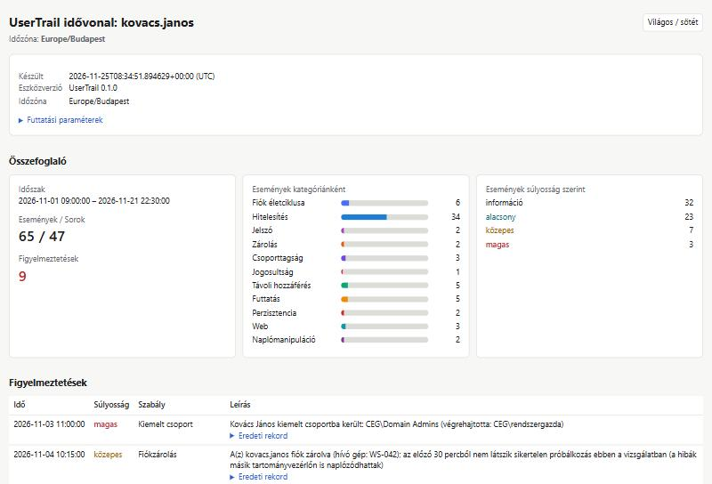
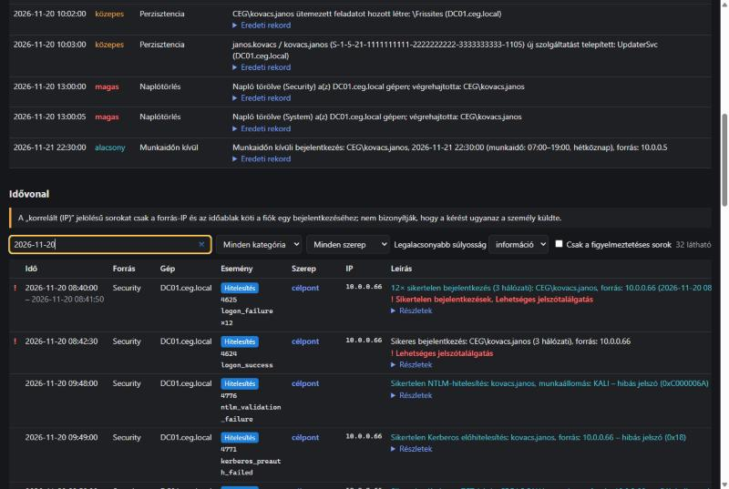

# UserTrail

**Felhasználóközpontú Windows forensic idővonal-építő.**

[](https://github.com/broist/UserTrail/actions/workflows/ci.yml)


Adj meg a UserTrailnek egy Active Directory fióknevet és a begyűjtött Windows-eseménynaplókat
(EVTX) és IIS-naplókat: egyetlen, időrendi idővonalat kapsz arról, **mi történt a fiókkal, és mit
csinált a fiók**. Benne vannak a bejelentkezések, a sikertelen próbálkozások, a jelszócserék, a
zárolások, a csoporttagság-változások, az RDP-munkamenetek, a PowerShell-futtatások és az
ugyanarról az IP-ről érkező webes kérések.

A Hayabusa, a Chainsaw és a plaso eseményközpontú eszközök: szabályok alapján keresnek gyanús
eseményeket. A UserTrail **identitásközpontú**: egy fiók teljes életútját rakja össze több
forrásból, és minden eseménynél jelzi, hogy a fiók **szereplő** volt (ő csinálta) vagy
**célpont** (vele csinálták).





*A képek a mellékelt, teljesen kitalált demo-vizsgálatból készültek (lásd lent).*

## Főbb jellemzők

- **Egy fiók, több forrás:** Security, System, RDP (TerminalServices), PowerShell/Operational
  EVTX és IIS W3C-naplók egyetlen idővonalon.
- **Identitás-normalizálás:** `DOMAIN\felhasználó`, UPN, puszta név, SID és DN egyaránt;
  SID ↔ név térkép a naplókból, így a csak SID-et tartalmazó események (PowerShell, 7045) is a
  fiókhoz kerülnek. Átnevezés (4781) után a régi és az új névvel is a teljes előzmény látszik.
- **Figyelmeztetések:** naplótörlés, kiemelt csoportba vétel, jelszótalálgatás, fiókzárolás az
  előzményeivel, munkaidőn kívüli bejelentkezés, jelszó-visszaállítás után új IP, perzisztencia.
- **IP-pivot:** a felhasználó bejelentkezési IP-címeiről érkező webes kérések, egyértelműen
  „korrelált” jelöléssel.
- **Forensic szemlélet:** a forrásfájlokat csak olvasásra nyitja meg, mindegyik SHA-256 hash-ét
  rögzíti, minden esemény visszakereshető az eredeti fájlig és rekordig, és minden riport
  tartalmazza az eszköz verzióját és a futtatás paramétereit.
- **Kimenetek:** konzol, CSV (Excel- és Timeline Explorer-barát), JSON Lines és egyetlen fájlból
  álló, hálózat nélkül is működő HTML-riport, világos és sötét módban.
- **Hiányok jelzése:** a `sources` parancs megmondja, mely naplók vagy auditálási beállítások
  hiányoznak, és ha a napló felülíródhatott.
- **Magyar és angol** leírások (`--lang hu|en`); Windowson, Linuxon és macOS-en is fut.

## Telepítés

### Letölthető futtatható fájl (Python nélkül)

A [Releases](https://github.com/broist/UserTrail/releases/latest) oldalon minden kiadáshoz van
önálló futtatható fájl, amelyhez nem kell Pythont telepíteni:

| Rendszer | Fájl |
|---|---|
| Windows (x64) | `usertrail-vX.Y.Z-windows-x64.exe` |
| Linux (x64, glibc 2.35+) | `usertrail-vX.Y.Z-linux-x64` |
| macOS (Apple Silicon) | `usertrail-vX.Y.Z-macos-arm64` |

Letöltés után érdemes a hash-t összevetni a mellékelt `SHA256SUMS.txt` fájllal, majd a fájlt
egyszerűen `usertrail.exe` (illetve `usertrail`) névre átnevezni:

```powershell
Get-FileHash .\usertrail-vX.Y.Z-windows-x64.exe -Algorithm SHA256
.\usertrail.exe --version
```

Linuxon és macOS-en: `sha256sum` (illetve `shasum -a 256`), majd `chmod +x usertrail`.

Tudnivalók:

- A fájl nincs digitálisan aláírva, ezért a Windows SmartScreen az első indításkor
  figyelmeztethet („Ismeretlen közzétevő”; *További információ → Futtatás mindenképp*). Egyes
  vírusirtók a PyInstallerrel készült programokat tévesen gyanúsnak jelölhetik: a hash alapján
  ellenőrizhető, hogy a fájl a kiadottal azonos. macOS-en a Gatekeeper miatt szükség lehet erre:
  `xattr -d com.apple.quarantine usertrail`.
- Az egyfájlos program indításkor kicsomagolja magát egy ideiglenes mappába, ezért 1–2
  másodperccel lassabban indul, mint a pip-pel telepített változat.

### Telepítés pip-pel

Python 3.11 vagy újabb kell hozzá. A csomag még nincs a PyPI-n, a GitHubról telepíthető:

```bash
pip install "git+https://github.com/broist/UserTrail.git@v0.1.1"
usertrail --version
```

Fejlesztéshez (a demo-vizsgálat is ebben a repóban van):

```bash
git clone https://github.com/broist/UserTrail.git
cd UserTrail
python -m venv .venv
. .venv/bin/activate            # Windowson: .venv\Scripts\activate
pip install -e ".[dev]"
```

## Gyors kezdés

### A gép aktuális naplóiból (élő gyűjtés)

Windowson, **rendszergazdaként** futtatott PowerShellből vagy parancssorból egyetlen parancs
elég: a UserTrail a gép mindenkori legfrissebb naplóiból dolgozik.

```powershell
.\usertrail.exe users
.\usertrail.exe timeline --user kovacs.janos --from 2026-11-01
.\usertrail.exe export --user kovacs.janos --from 2026-11-01 -o riport.html
.\usertrail.exe sources
```

Ha sem `--case`, sem `--source` nincs megadva, a program:

1. a Windows saját `wevtutil epl` parancsával pillanatképet ment a Security, a System, az RDP-
   és a PowerShell-naplóról egy ideiglenes mappába (a `--from` időszakkal szűrve, így gyorsabb),
   és a mentett másolatból dolgozik, a hash-ét is abból számolja. Az élő naplókat semmi nem
   módosítja;
2. az IIS-naplók helyét a `applicationHost.config` fájlból olvassa ki (webhelyenként), és ezeket
   a helyükön, csak olvasásra nyitja meg;
3. a futás végén törli az ideiglenes másolatokat. A `--save-logs <mappa>` megőrzi őket, például
   hogy a riport hash-ei később is ellenőrizhetők legyenek.

A Security naplóhoz rendszergazdai jog kell; enélkül a program figyelmeztet, és a többi naplóból
dolgozik. Az IIS-naplók a `--no-iis` kapcsolóval kihagyhatók. A riport futtatási paraméterei
(`live`) rögzítik a gép nevét, a gyűjtés idejét és csatornánként a mentés eredményét. Az éppen
írt IIS-naplófájl hash-e a feldolgozás után még változhat.

### Begyűjtött naplókból

Másik gépről kimásolt naplókkal, három paranccsal:

```bash
usertrail ingest ./bizonyitekok/ --case ugy.db
usertrail timeline --case ugy.db --user "CEG\kovacs.janos" --tz Europe/Budapest
usertrail export --case ugy.db --user kovacs.janos --tz Europe/Budapest -o riport.html
```

Az `ingest` a mappát rekurzívan bejárja, felismeri az `.evtx` és az IIS `.log` fájlokat, és
mindegyik SHA-256 hash-ét rögzíti. A már betöltött fájlokat (azonos hash) kihagyja, így többször
is lefuttatható ugyanarra a mappára.

### Kipróbálás a demo-vizsgálattal

A repóban egy kitalált fiók (`CEG\kovacs.janos`) teljes életútja van egy vizsgálati
adatbázisban: létrehozás, jelszó-visszaállítás, kiemelt csoportba vétel, zárolás,
jelszótalálgatás, RDP- és webes munka, PowerShell, szolgáltatástelepítés, naplótörlés, átnevezés
és törlés. A klónozott repó gyökeréből:

```bash
usertrail users    --case examples/demo/demo-case.db
usertrail timeline --case examples/demo/demo-case.db --user kovacs.janos --tz Europe/Budapest --collapse
usertrail sources  --case examples/demo/demo-case.db
```

Az elkészített riport: [examples/demo/riport.html](examples/demo/riport.html) (töltsd le és nyisd
meg böngészőben). Az adatbázist az [examples/build_demo.py](examples/build_demo.py) építi újra a
tesztek szintetikus fixture-jeiből. **Minden adat kitalált.**

## Parancsok

| Parancs | Mire való |
|---|---|
| `ingest <útvonal>... --case ugy.db` | Naplók betöltése vizsgálati adatbázisba (hash-ek, duplikáció-szűrés, folyamatjelző) |
| `sources [--case ugy.db]` | Milyen naplók és események vannak, és mi hiányzik |
| `users [--case ugy.db]` | Az összes ismert fiók, SID szerint összevonva, első és utolsó eseménnyel |
| `timeline [--case ugy.db] --user ...` | Egy fiók (vagy IP) idővonala a konzolon |
| `export [--case ugy.db] --user ... -f html\|csv\|json -o fájl` | Idővonal fájlba |

A `timeline`, az `export`, a `users` és a `sources` három forrásból dolgozhat:

- **semmi megadása nélkül** a futtató gép aktuális naplóiból (élő gyűjtés, lásd fent);
- `--source ./mappa/`: közvetlenül naplófájlokból, adatbázis nélkül (csak `timeline`, `export`);
- `--case ugy.db`: egy korábban betöltött vizsgálati adatbázisból.

A `--user` elfogadja a `DOMAIN\felhasználó`, az UPN (`felhasználó@domain`) és a puszta név
alakot, a `--sid` SID-et vár, az `--ip` forrás-IP-re szűr (a `--user`-rel együtt szűkít). A nevek
összehasonlítása kis- és nagybetűtől független.

### Hasznos kapcsolók

| Kapcsoló | Jelentés |
|---|---|
| `--from` / `--to` | Időszak a megjelenítési időzónában; egy dátum az egész napot jelenti |
| `--tz` | Megjelenítési időzóna, pl. `Europe/Budapest` (alapértelmezés: a gép helyi ideje) |
| `--category` | Kategóriák vesszővel elválasztva, pl. `AUTHENTICATION,PRIVILEGE` |
| `--min-severity` | Legalacsonyabb súlyosság: `info`, `low`, `medium`, `high` |
| `--include-machine-accounts` | A `$` végű gépfiókok eseményei is látszanak |
| `--pivot-ip`, `--pivot-window` | Webes kérések a bejelentkezési IP-címekről (korrelált), időablak percben (60) |
| `--iis-tz` | Az IIS-naplók időzónája, ha nem UTC-ben naplóznak |
| `--collapse`, `--collapse-gap` | Zajos események összevonása (alapértelmezett szünet: 15 perc) |
| `--fail-threshold`, `--fail-window` | Sikertelen bejelentkezések küszöbe (10) és időablaka (5 perc) |
| `--work-hours` | Munkaidő, pl. `07:00-19:00` (hétköznap, a `--tz` szerint) |
| `--no-alerts` | Figyelmeztetések kikapcsolása |
| `--lang` | A leírások nyelve: `hu` (alapértelmezés) vagy `en` |

### Figyelmeztetések

Az idővonal alatt egy „Figyelmeztetések” tábla jelenik meg, az érintett sorokat pedig „!” jelöli.
A szabályok a keresett fiók összes eseményén futnak, a `--category` és a `--min-severity`
szűrőtől függetlenül (csak az időszakszűrő érvényes):

| Szabály | Mikor jelez | Súlyosság |
|---|---|---|
| Naplótörlés | Security 1102, System 104 | magas |
| Kiemelt csoport | Domain/Schema/Enterprise Admins vagy Administrators csoportba vétel | magas |
| Lehetséges jelszótalálgatás | sikeres bejelentkezés legalább 5 sikertelen után, 5 percen belül | magas |
| Fiókzárolás | 4740, az előző 30 perc sikertelen próbálkozásaival összekötve | közepes |
| Sikertelen bejelentkezések | legalább 10 hiba 5 percen belül (`--fail-threshold`, `--fail-window`) | közepes |
| Jelszó-visszaállítás + új IP | 4724 után 1 órán belül bejelentkezés korábban nem látott IP-ről | közepes |
| Perzisztencia | új szolgáltatás (7045) vagy ütemezett feladat (4698) a felhasználó nevében | közepes |
| Munkaidőn kívül | interaktív/RDP-bejelentkezés munkaidőn kívül | alacsony |

Sikertelen bejelentkezésnek számít a 4625, a 4771, a sikertelen 4768 és a sikertelen 4776.

### IP-pivot

A felhasználó nevével naplózott webes kérések (`cs-username`) közvetlen találatok. A
`--pivot-ip` ezen felül behúzza azokat a kéréseket is, amelyek a felhasználó **sikeres
bejelentkezéseinek** (4624, sikeres 4768, RDP 1149/21) IP-címeiről érkeztek ±`--pivot-window`
percen belül. Ezek **„korrelált (IP)”** jelölést kapnak, és minden ilyen sor megőrzi, melyik
bejelentkezéshez kötötte az eszköz.

### Zajos események összevonása

A `--collapse` az ismétlődő eseményeket (pl. sok hálózati bejelentkezés vagy Kerberos-jegy
ugyanarról az IP-ről) egy sorba vonja: „12× sikertelen bejelentkezés (3 hálózati):
CEG\kovacs.janos, forrás: 10.0.0.66 (08:40:00 – 08:41:50)”. Csak az információ és alacsony
súlyosságú eseményeket vonja össze, legalább 3-at; az összevont sor minden eredeti rekordra
hivatkozik.

### Kimenetek

- **HTML:** egyetlen önálló fájl, külső hivatkozás nélkül. Összefoglaló, figyelmeztetések,
  kereshető és szűrhető idővonal, kategóriaszínek, szereplő/célpont jelölés, kinyitható részletek
  a nyers mezőkkel, a forrásfájlok listája SHA-256 hash-sel, időzóna, eszközverzió és futtatási
  paraméterek. A naplóból származó szöveg escape-elve kerül bele, így nem futhat le.
- **CSV:** UTF-8 BOM-mal (Excel). Az oszlopnevek angolok (`Timestamp`, `EventID`, `Description`
  …), mert ezeket gépi eszközök, pl. a Timeline Explorer dolgozzák fel. Mellé egy
  `<név>.meta.json` kerül a paraméterekkel, a hash-ekkel és a figyelmeztetésekkel.
- **JSON Lines:** az első sor a metaadat (`"type": "meta"`), utána a figyelmeztetések
  (`"alert"`), majd az események (`"event"`).

## Naplók összegyűjtése egy Windows-szerverről

A futó rendszeren a naplófájlok zárolva vannak, ezért exportálni kell őket. Rendszergazdai
PowerShellben:

```powershell
$cel = "E:\gyujtes\$env:COMPUTERNAME"
New-Item -ItemType Directory -Force $cel | Out-Null
wevtutil epl Security "$cel\Security.evtx"
wevtutil epl System "$cel\System.evtx"
wevtutil epl Microsoft-Windows-PowerShell/Operational "$cel\PowerShell-Operational.evtx"
wevtutil epl Microsoft-Windows-TerminalServices-LocalSessionManager/Operational "$cel\RDP-LocalSessionManager.evtx"
wevtutil epl Microsoft-Windows-TerminalServices-RemoteConnectionManager/Operational "$cel\RDP-RemoteConnectionManager.evtx"
Get-FileHash "$cel\*.evtx" -Algorithm SHA256 | Export-Csv "$cel\hash.csv" -NoTypeInformation
```

| Forrás | Hol van | Mit ad |
|---|---|---|
| Security | `C:\Windows\System32\winevt\Logs\Security.evtx` | bejelentkezés, fiókkezelés, csoportok, Kerberos, naplótörlés |
| System | `...\Logs\System.evtx` | szolgáltatástelepítés (7045), naplótörlés (104) |
| RDP | `...\Logs\Microsoft-Windows-TerminalServices-*%4Operational.evtx` | RDP-munkamenetek és -hitelesítés |
| PowerShell | `...\Logs\Microsoft-Windows-PowerShell%4Operational.evtx` | szkriptblokkok (4104) |
| IIS | `C:\inetpub\logs\LogFiles\W3SVC<n>\u_exYYMMDD.log` | webes kérések (sima fájlmásolás elég) |

Tanácsok:

- **Minden tartományvezérlőről** gyűjts: a hitelesítési események (4768, 4771, 4776, 4740) azon a
  DC-n naplózódnak, amelyik a kérést kiszolgálta.
- A naplók átnevezhetők: a csatornát az eszköz a rekordokból állapítja meg, nem a fájlnévből.
- Az IIS alapból UTC-ben naplóz; ha a szerveren helyi időre állították, használd az
  `--iis-tz` kapcsolót.
- A begyűjtött fájlokat csak olvasható másolatként elemezd; a hash-eket a `sources` és minden
  riport is tartalmazza.

## Ajánlott auditbeállítások

Az eszköz csak abból dolgozik, ami a naplókban benne van. Az *Advanced Audit Policy*
alkategóriáit csoportházirendben (*Computer Configuration > Policies > Windows Settings >
Security Settings > Advanced Audit Policy Configuration*) vagy `auditpol`-lal lehet bekapcsolni.
Az alkategóriák neve honosított (magyar Windowson pl. „Bejelentkezés”), ezért az alábbi
parancsok a nyelvfüggetlen GUID-ot használják:

| Alkategória | GUID | Siker | Hiba | Események |
|---|---|---|---|---|
| Logon | `{0CCE9215-69AE-11D9-BED3-505054503030}` | ✔ | ✔ | 4624, 4625, 4648 |
| Logoff | `{0CCE9216-69AE-11D9-BED3-505054503030}` | ✔ | | 4634, 4647 |
| Account Lockout | `{0CCE9217-69AE-11D9-BED3-505054503030}` | | ✔ | 4625 (zárolt fiók) |
| Special Logon | `{0CCE921B-69AE-11D9-BED3-505054503030}` | ✔ | | 4672 |
| Process Creation | `{0CCE922B-69AE-11D9-BED3-505054503030}` | ✔ | | 4688 |
| Other Object Access Events | `{0CCE9227-69AE-11D9-BED3-505054503030}` | ✔ | ✔ | 4698 |
| User Account Management | `{0CCE9235-69AE-11D9-BED3-505054503030}` | ✔ | ✔ | 4720–4726, 4738, 4740, 4767, 4781 |
| Security Group Management | `{0CCE9237-69AE-11D9-BED3-505054503030}` | ✔ | | 4728–4757 |
| Credential Validation (DC) | `{0CCE923F-69AE-11D9-BED3-505054503030}` | ✔ | ✔ | 4776 |
| Kerberos Service Ticket Operations (DC) | `{0CCE9240-69AE-11D9-BED3-505054503030}` | ✔ | ✔ | 4769 |
| Kerberos Authentication Service (DC) | `{0CCE9242-69AE-11D9-BED3-505054503030}` | ✔ | ✔ | 4768, 4771 |

```powershell
$mindketto = '{0CCE9215-69AE-11D9-BED3-505054503030}','{0CCE9227-69AE-11D9-BED3-505054503030}',
             '{0CCE9235-69AE-11D9-BED3-505054503030}','{0CCE923F-69AE-11D9-BED3-505054503030}',
             '{0CCE9240-69AE-11D9-BED3-505054503030}','{0CCE9242-69AE-11D9-BED3-505054503030}'
$csakSiker = '{0CCE9216-69AE-11D9-BED3-505054503030}','{0CCE921B-69AE-11D9-BED3-505054503030}',
             '{0CCE922B-69AE-11D9-BED3-505054503030}','{0CCE9237-69AE-11D9-BED3-505054503030}'
foreach ($g in $mindketto) { auditpol /set /subcategory:$g /success:enable /failure:enable }
foreach ($g in $csakSiker) { auditpol /set /subcategory:$g /success:enable }
auditpol /set /subcategory:'{0CCE9217-69AE-11D9-BED3-505054503030}' /failure:enable
```

További beállítások:

- **Parancssor a 4688-ban:** *Administrative Templates > System > Audit Process Creation >
  Include command line in process creation events* (registry:
  `HKLM\SOFTWARE\Microsoft\Windows\CurrentVersion\Policies\System\Audit`,
  `ProcessCreationIncludeCmdLine_Enabled = 1`).
- **PowerShell-szkriptblokkok (4104):** *Administrative Templates > Windows Components > Windows
  PowerShell > Turn on PowerShell Script Block Logging* (registry:
  `HKLM\SOFTWARE\Policies\Microsoft\Windows\PowerShell\ScriptBlockLogging`,
  `EnableScriptBlockLogging = 1`).
- **Naplóméret:** az alapértelmezett 20 MB-os Security-napló egy forgalmas tartományvezérlőn
  órák alatt felülíródik. Érdemes legalább 1 GB-ot beállítani:
  `wevtutil sl Security /ms:1073741824`.
- **IIS:** a `cs-username`, `c-ip`, `cs(User-Agent)` és `sc-status` mezők legyenek bekapcsolva
  (alapból be vannak).

Labor a valós teszteléshez: egy tartományvezérlő és egy IIS-szerver virtuális gépen, a fenti
beállításokkal; próbálj ki bejelentkezést, hibás jelszót, zárolást, csoportba vételt, RDP-t és
egy PowerShell-szkriptet, majd gyűjtsd be a naplókat.

## Támogatott események

| Forrás | Event ID | Mit jelent |
|---|---|---|
| Security | 4624, 4625 | sikeres / sikertelen bejelentkezés (típus, forrás-IP, hibakód magyarázattal) |
| Security | 4634, 4647 | kijelentkezés |
| Security | 4648 | bejelentkezés explicit hitelesítő adatokkal |
| Security | 4672 | kiemelt jogosultságú bejelentkezés |
| Security | 4768, 4769, 4771 | Kerberos TGT, szolgáltatásjegy, sikertelen előhitelesítés (hibakóddal) |
| Security | 4776 | NTLM-hitelesítés ellenőrzése |
| Security | 4720, 4722, 4725, 4726, 4738, 4781 | fiók létrehozása, engedélyezése, letiltása, törlése, módosítása, átnevezése |
| Security | 4723, 4724 | jelszómódosítás, jelszó-visszaállítás (sikeresség szerint) |
| Security | 4740, 4767 | fiókzárolás (a hívó géppel), feloldás |
| Security | 4728/4729, 4732/4733, 4756/4757 | tag felvétele/eltávolítása globális, helyi, univerzális csoportban |
| Security | 1102 | a Security-napló törlése |
| Security | 4688 | folyamatindítás (parancssorral, ha naplózva van) |
| Security | 4698 | ütemezett feladat létrehozása |
| System | 7045 | szolgáltatás telepítése |
| System | 104 | napló törlése |
| TerminalServices-LocalSessionManager | 21, 23, 24, 25 | RDP-bejelentkezés, -kijelentkezés, -bontás, -újracsatlakozás |
| TerminalServices-RemoteConnectionManager | 1149 | sikeres RDP hálózati hitelesítés |
| PowerShell/Operational | 4104 | szkriptblokk (a több részre bontottak összefűzve) |
| IIS (W3C) | – | webes kérések (a `#Fields:` sor szerinti mezősorrenddel) |

Új eseménytípus hozzáadása általában egyetlen bejegyzés: lásd a
[CONTRIBUTING.md](CONTRIBUTING.md)-t.

## Korlátok

- **A korrelált IIS-találatok nem bizonyítékok.** Csak azt mutatják, hogy ugyanarról az IP-ről,
  egy bejelentkezéshez közeli időben jött kérés; NAT, proxy vagy terminálszerver mögül ez bárki
  lehetett.
- **Ami nincs a naplóban, az nem látszik.** Kikapcsolt auditálás, felülírt vagy törölt napló,
  hiányzó tartományvezérlő esetén az idővonal hiányos; a `sources` parancs ezekre figyelmeztet.
- **A SID ↔ név összerendelés a naplókból tanult.** Ha egy fiók neve sehol sem szerepel a SID-jével
  együtt, a csak SID-del naplózott események nem köthetők a névhez (fordítva is). A csoport-
  eseményekben a tag DN-jéből kinyert név megjelenítendő név, nem felhasználónév.
- **A gépfiókok** (`$` végű nevek) alapból kimaradnak (`--include-machine-accounts`).
- **Csak a felsorolt Event ID-k** kerülnek az idővonalra; Sysmon, Defender, Task Scheduler,
  Prefetch és registry-források még nincsenek.
- **Időzónák:** a tárolás UTC-ben történik; az IIS-naplók helyes értelmezéséhez tudni kell, hogy
  a szerver UTC-ben vagy helyi időben naplózott (`--iis-tz`). A munkaidő-szabály a `--tz`
  időzónájában értendő.
- **Érettség:** a v0.1.0 az első kiadás. A tesztek szintetikus adatokon futnak; éles vizsgálat
  előtt érdemes a saját környezetben, ismert eseményekkel ellenőrizni az eredményt.

## Hozzájárulás

Hibajelentést és pull requestet szívesen fogadunk. A fejlesztői környezet, az ellenőrzések
(`ruff`, `mypy --strict`, `pytest`) és az új eseménytípusok hozzáadásának módja a
[CONTRIBUTING.md](CONTRIBUTING.md)-ben van. A változások listája: [CHANGELOG.md](CHANGELOG.md).

## Licenc

MIT, lásd: [LICENSE](LICENSE).
